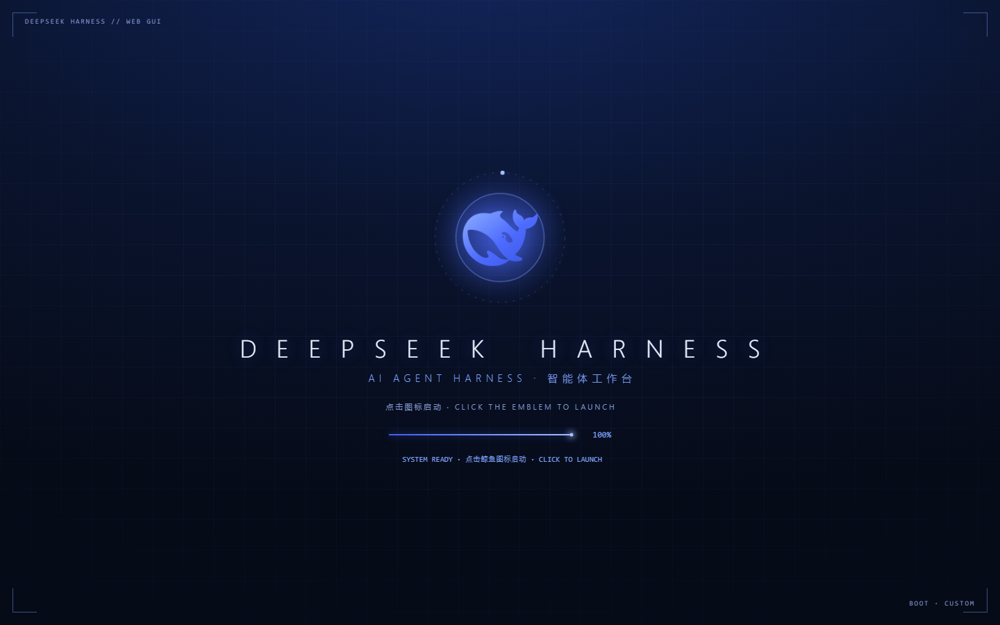

# dsh-boot-rhine

给 [DeepSeek Harness](https://deepseek.com)（DSH）桌面版换一套**开屏动画 + 主图壁纸主题**：
深海军蓝 + 品牌蓝、官方鲸鱼徽记、进度与启动状态机，点击徽记进入；进入后整页蓝色调色板，
可把任意图片作为应用壁纸。



> 非官方项目，与 DeepSeek 无关。鲸鱼图形来自 DeepSeek 品牌资产，仅用于个人主题。

## 它做什么

- **开屏动画**：鲸鱼徽记淡入、标题逐字母升起、进度条推进、启动状态轮播；就绪后呼吸
  脉动，提示“点击启动”；点击（或 Enter / 空格 / Esc）扩散光环并淡出。
- **启动门**：应用没就绪时提前点击会显示 `LAUNCH ACCEPTED · WAITING FOR HARNESS…`，
  就绪后自动进入；插件加载失败会显示故障信息，可点击跳过。
- **整页主题**：覆盖 DSH 的 `--dsw-*` 调色板 token，深蓝底 + `#4d6bfe` 品牌蓝，
  只影响深色模式，不写任何设置。
- **壁纸**：图片 base64 进 CSS，挂在应用最外层框架；内容链路透明，对话列加毛玻璃卡片
  保证可读；支持焦点、压暗、左边缘渐隐。
- **可重播**：`Ctrl+Alt+B` 随时重播开屏。
- **不污染安装**：全部通过 cordis 插件注入，不修改 DSH 安装目录。

## 前置条件

- DSH 桌面版（2026-10 nightly 上测试；Windows x64）
- Node.js 20+（DSH 自带运行时也行，`install.ps1` 会自动找）

## 安装

```bash
git clone https://github.com/nauxbx/dsh-boot-rhine.git ~/.dsh/skills/dsh-boot-rhine
```

Windows PowerShell：

```powershell
git clone https://github.com/nauxbx/dsh-boot-rhine.git "$HOME\.dsh\skills\dsh-boot-rhine"
```

重启 DSH（或新开会话），skill 会出现在会话目录里。然后二选一：

- 对 agent 说：**“帮我装 dsh-boot-rhine 开屏，壁纸用 `D:\pics\bg.jpg`”**
- 或者直接运行：

```bash
node ~/.dsh/skills/dsh-boot-rhine/scripts/install.mjs --wallpaper "D:/pics/bg.jpg"
```

**装完必须完全退出并重新打开 DSH**（桌面窗口的注入表在启动时快照一次）。
外部浏览器刷新 DSH 页面可立即看到效果。

没有壁纸图：

```bash
node ~/.dsh/skills/dsh-boot-rhine/scripts/install.mjs --gradient
```

## 使用

| 操作 | 方式 |
| --- | --- |
| 重播开屏 | `Ctrl+Alt+B` |
| 预览（不用装） | `node scripts/preview.mjs`，打开 `preview/index.html` |
| 体检 | `node scripts/doctor.mjs` |
| 换壁纸 | `node scripts/make-bg.mjs "D:\pics\new.jpg"` 后重启 |
| 只要主题 | `node scripts/install.mjs --theme-only` |
| 只要开屏 | `node scripts/install.mjs --splash-only` |
| 恢复全部 | `node scripts/install.mjs --all` |
| 不强制深色 | `node scripts/install.mjs --no-force-dark` |
| 卸载 | `node scripts/uninstall.mjs` 后重启 |

## 定制

所有定制都改 skill 里的 `assets/plugin/`，再跑 `scripts/install.mjs` 覆盖安装。

| 想改 | 文件 |
| --- | --- |
| 主色 / 背景 / 文字 / 边框 | `assets/plugin/lib/theme.css` |
| 标题、副标题、水印、时长 | `assets/plugin/lib/boot.js` 顶部 `cfg` |
| 壁纸焦点、压暗、卡片浓度 | `assets/plugin/selectors.json` |
| 动效、徽记、HUD | `assets/plugin/lib/boot.css` + `boot.js` |

配置在 `~/.dsh/profiles/<profile>/cordis.patch.yml` 的 `- id: boot-rhine` 块：

```yaml
- insert:
    - id: boot-rhine
      name: "file:///.../lib/index.js?v=..."
      config:
        enabled: true
        splashEnabled: true
        themeEnabled: true
        forceDark: true
        minDisplayMs: 1500
        maxDisplayMs: 3300
        autoLaunchMs: 0
        fadeMs: 450
```

⚠ 不要把中文写进这个 YAML（本机配置编辑器的 UTF-8 往返问题）；中文放 `boot.js` 默认值。

## 目录

```
SKILL.md                  # agent 入口
scripts/install.mjs       # 复制插件 + 注册 + 备份
scripts/uninstall.mjs     # 卸载
scripts/make-bg.mjs       # 图片 → theme-bg.css
scripts/preview.mjs       # 独立预览页
scripts/doctor.mjs        # 体检
assets/plugin/            # 插件源码（安装时复制到 profile）
references/               # 架构、选择器、定制、排查、分发
```

## 兼容性

在 Windows x64、DSH 2026-10 nightly 上验证。开屏使用的是稳定选择器
（`#dsh-rhine-overlay`、`[data-dsh-boot]`），一般不受版本影响；壁纸依赖 CSS Modules
哈希类名，DSH 升级后若错位，按 [`references/selectors.md`](references/selectors.md)
重新采集，只改 `selectors.json` 即可。

## 排查

常见问题见 [`references/troubleshooting.md`](references/troubleshooting.md)：

- 桌面没变化 → 必须完全退出重开
- 壁纸不出现 → 类名过期 / 没开深色 / theme-bg 没生成
- 改 CSS 不生效 → 桌面快照，先用浏览器调
- 中文乱码 → 配置层不要写中文

## 卸载

```bash
node ~/.dsh/skills/dsh-boot-rhine/scripts/uninstall.mjs
```

完全退出并重开 DSH。

## License

MIT。见 [LICENSE](LICENSE)。
